# EhViewer for iOS

[简体中文](README.md) | English

A native iOS client for E-Hentai / ExHentai, ported from the Android app [Ehviewer_CN_SXJ](https://github.com/xiaojieonly/Ehviewer_CN_SXJ). Written in Swift and SwiftUI, it runs on iPhone and iPad (iOS 17 or later).

> [!IMPORTANT]
> - This is an unofficial client. It is not affiliated with E-Hentai. The site hosts adult content: adults only, and please follow your local laws.
> - The app provides no content of its own; everything comes from the site.
> - The app will never be on the App Store. You sign and install it yourself, see [Installation](#installation).
> - The user interface is in Simplified Chinese only.

| Browse | Gallery details | Reader |
|:-:|:-:|:-:|
| 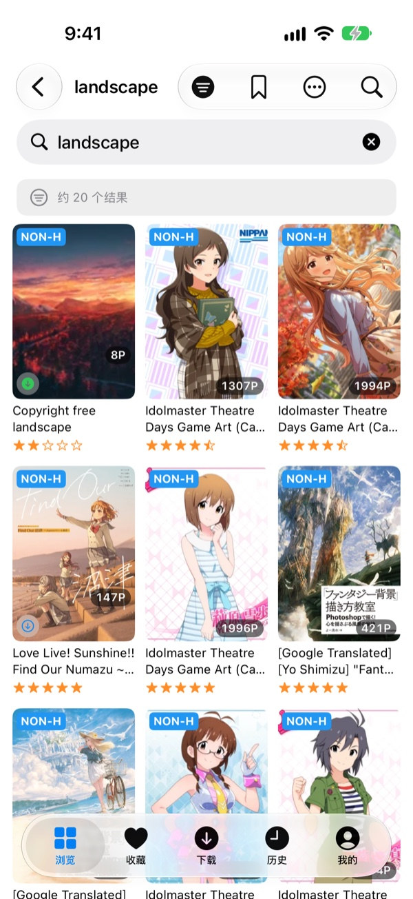 | 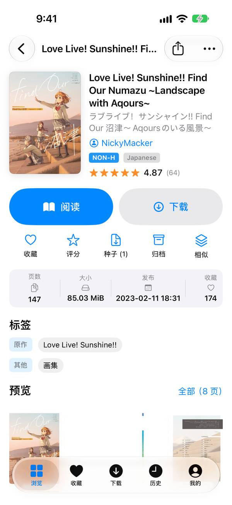 | 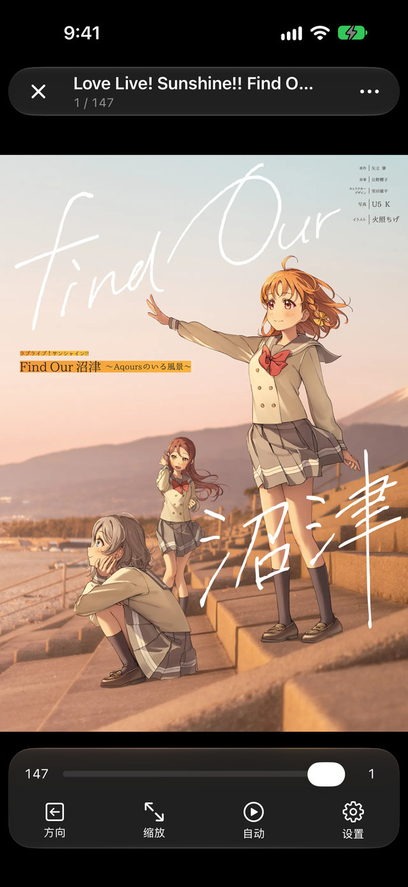 |
| **Tag suggestions (Chinese translations)** | **Downloads** | **Dark mode** |
| 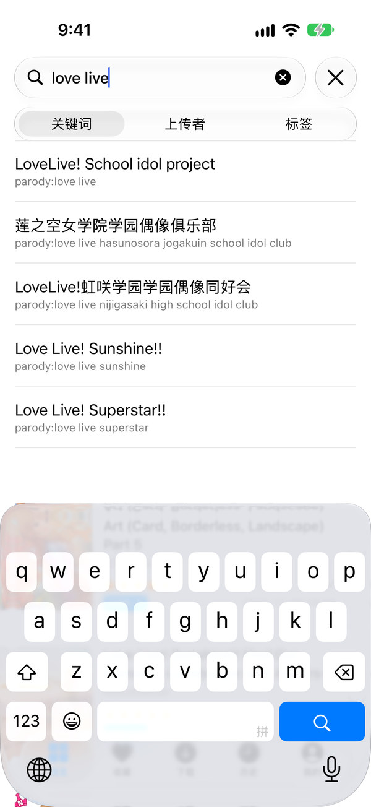 | 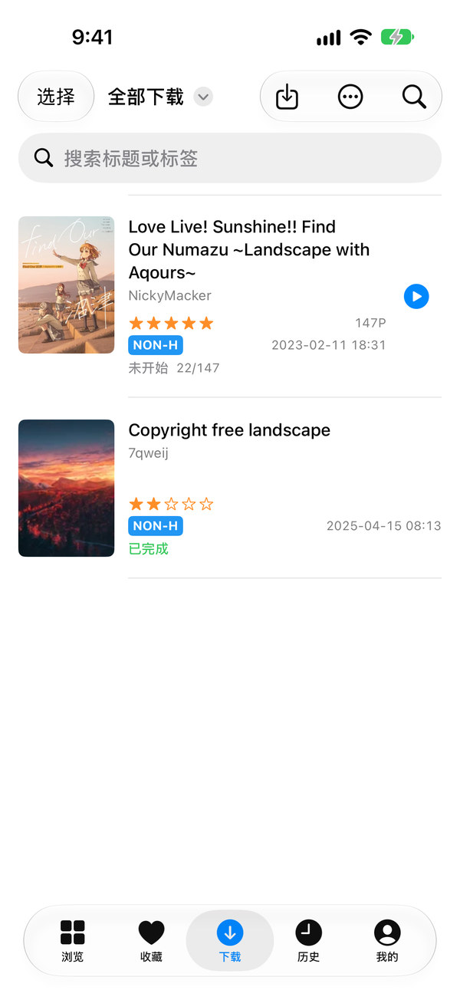 | 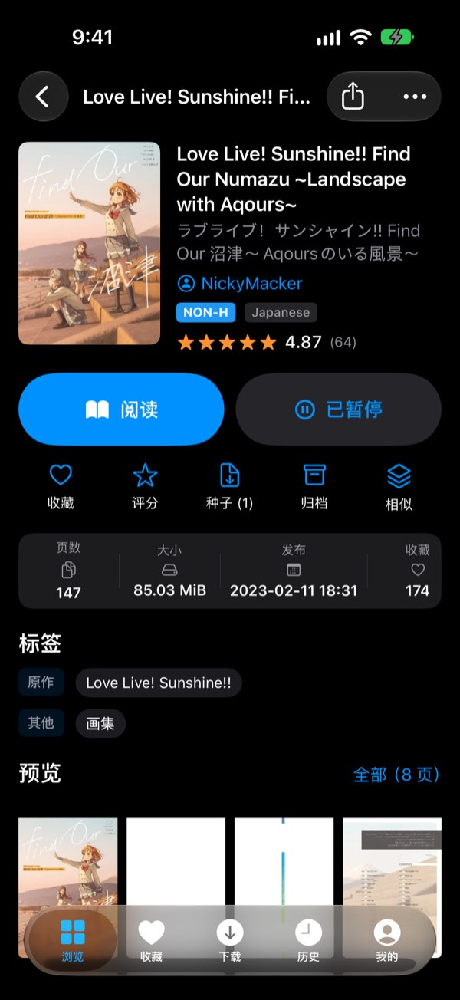 |

<details>
<summary><b>More screenshots (including iPad)</b></summary>

| List layout | Previews | Context menu |
|:-:|:-:|:-:|
| 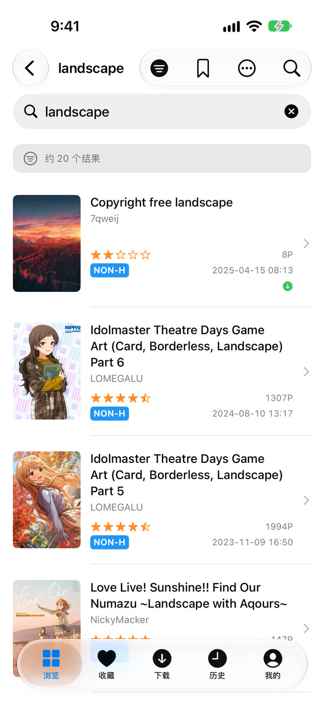 | 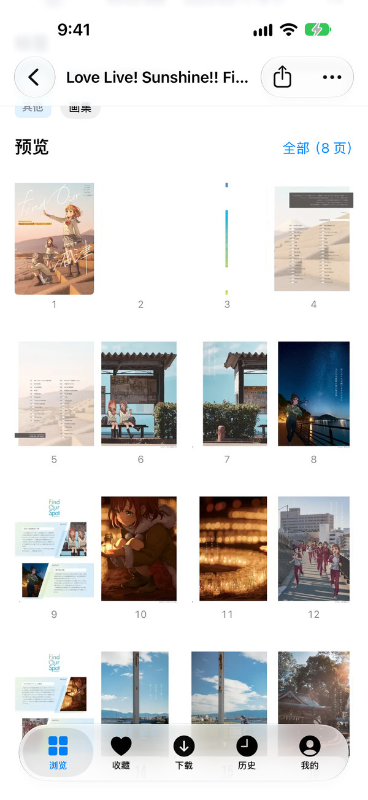 | 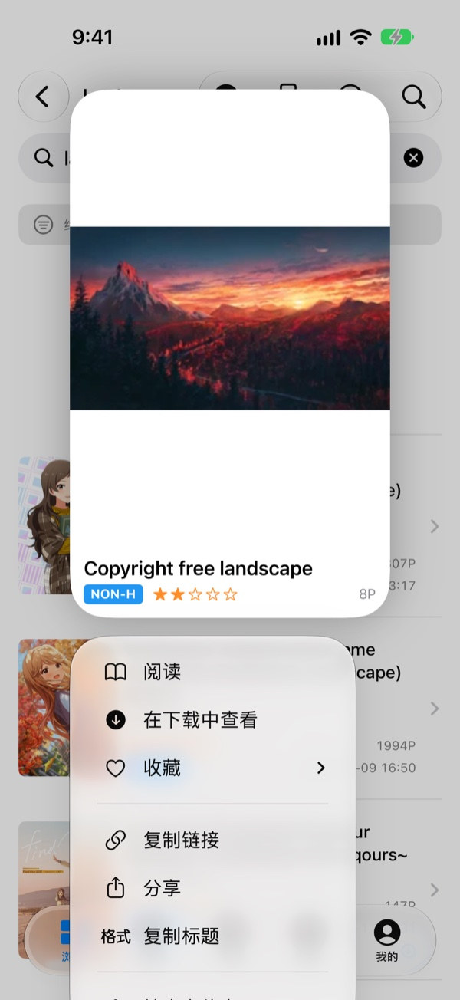 |
| **Vertical reading** | **Reader settings** | **Background download setting** |
| 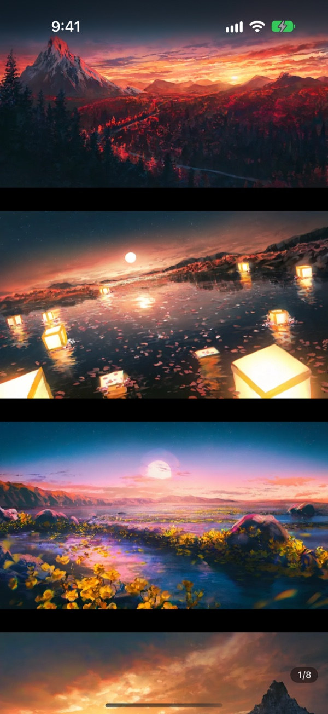 | 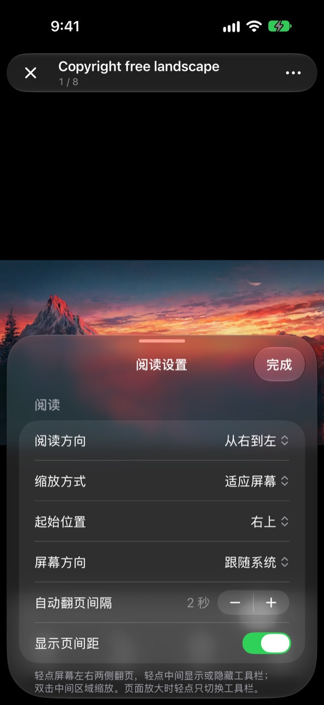 | 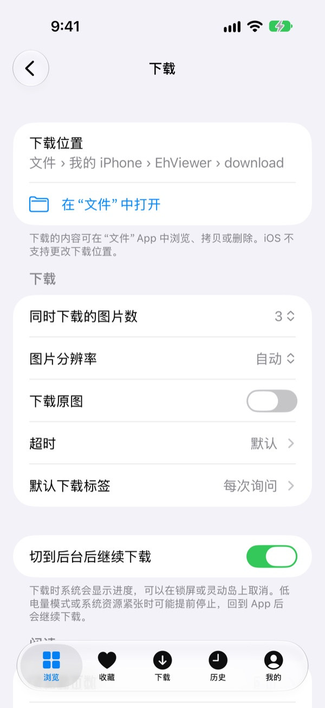 |
| **Me** | **Network settings** | **Wi-Fi transfer** |
| 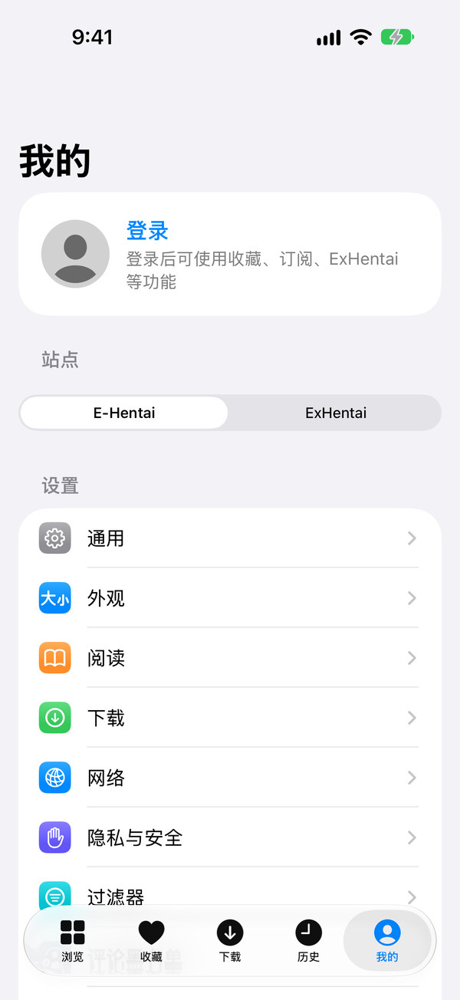 | 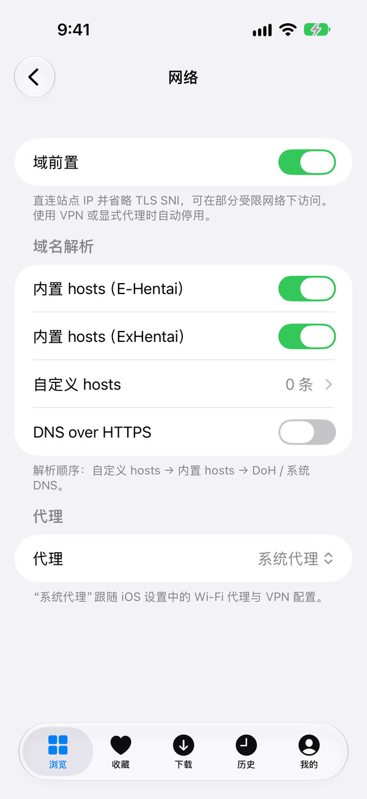 | 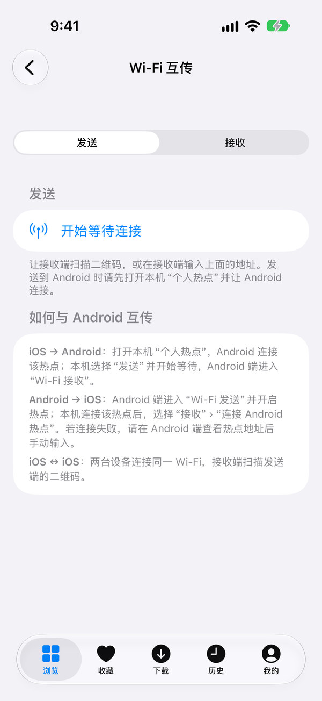 |

**iPad**

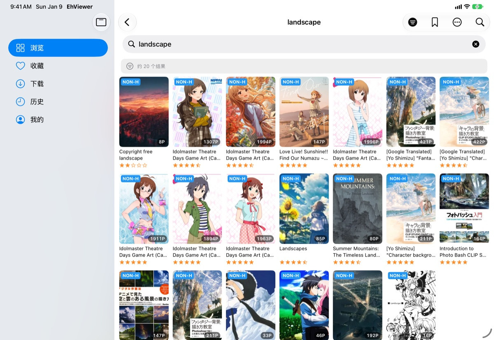

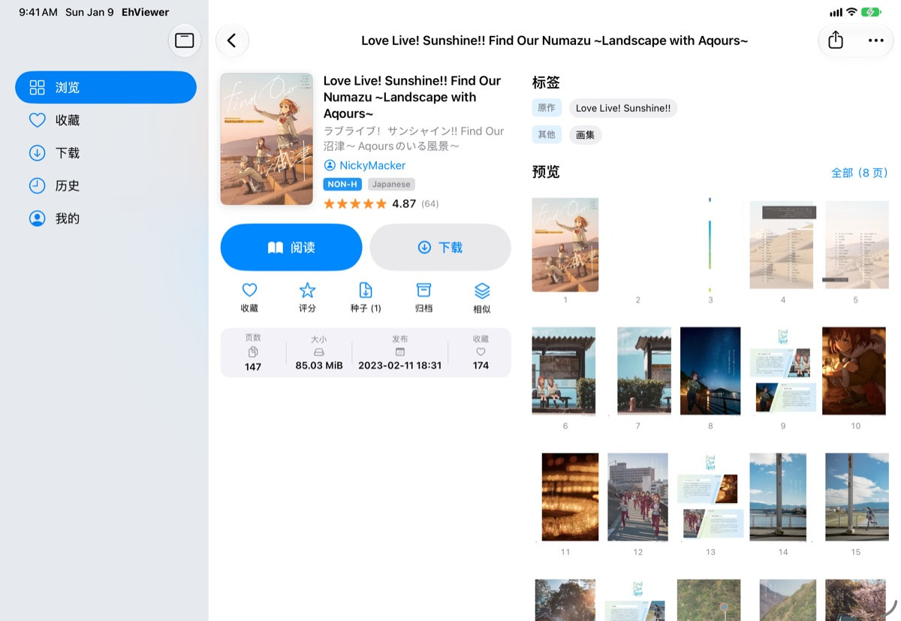

</details>

## Contents

- [Background](#background)
- [Features](#features)
- [Installation](#installation)
  - [Option 1: build and install with Xcode (recommended)](#option-1-build-and-install-with-xcode-recommended)
  - [Option 2: install the IPA with a signing tool](#option-2-install-the-ipa-with-a-signing-tool)
- [Getting started](#getting-started)
- [FAQ](#faq)
- [Differences from the Android app](#differences-from-the-android-app)
- [Development](#development)
- [Acknowledgements](#acknowledgements)
- [License](#license)

## Background

EhViewer is an E-Hentai client for Android, originally written by Hippo Seven ([seven332](https://github.com/seven332/EhViewer)). After the original stopped being developed, the community started several forks. One of them, [Ehviewer_CN_SXJ](https://github.com/xiaojieonly/Ehviewer_CN_SXJ) (maintained by xiaojieonly), targets Chinese-speaking users and is still updated today.

Ehviewer_CN_SXJ only exists for Android. This project ports it to iPhone and iPad:

- **A native rewrite.** No web wrapper and no cross-platform framework: everything is rewritten in Swift.
- **Same behavior, shared data.**
  - The business logic was translated from the Android source, file by file. That covers HTML parsing, search URL building, reader loading (SpiderQueen), download management, the `.ehviewer` file format, the database schema and the Wi-Fi transfer protocol.
  - As a result, you can import the Android app's download folder, data and settings, and exchange downloads with Android devices over Wi-Fi.
  - The Android unit test fixtures and assertions were ported too; EhKit now has almost 400 unit tests.
- **An interface designed for iOS.** It uses a tab bar, search bars, context menus, sheets and swipe actions, following Apple's Human Interface Guidelines.

## Features

| Area | What it does |
|---|---|
| Browse | Front page, watched, popular, toplists, News; list and grid layouts; keyword, uploader and tag search; tag suggestions with Chinese translations; advanced search; image search; quick search; jump to a page or a date |
| Gallery details | Info, tags (with Chinese translations), favorites (cloud slots 0–9 or local), rating, comments (post, edit, vote), previews, torrents, archive download (unpacked into downloads automatically), newer versions, similar galleries |
| Reader | Left-to-right or right-to-left paging, vertical scrolling; scale modes and start position; downsampled decoding; GIF; auto page turning; volume-key and keyboard paging; brightness; save to Photos, share; orientation lock |
| Downloads | Labels, batch actions, sorting and filters, search by title and tag (same syntax as the site, with tag suggestions), completion notifications; import zip files, folders or the Android download folder; restore downloads, clean up redundant or invalid items |
| Background downloads | iOS 26 and later: downloads keep going after you leave the app or lock the screen, and the system shows the progress on the Lock Screen and in the Dynamic Island. iOS 17 and 18: downloads continue for only about 30 seconds in the background, then resume when the system allows. See the [FAQ](#faq) |
| Account | Sign in with password, cookies or the web page; image limits and reset; My Tags; uconfig |
| Network | Domain fronting (connect by IP without SNI, verify the certificate against the real host name), built-in hosts, custom hosts, DNS over HTTPS, HTTP/SOCKS proxy |
| Other | Filters, comment blacklist, app lock (Face ID / passcode), privacy screen in the app switcher, data import and export (compatible with the Android database and settings), Wi-Fi transfer (works with Android) |

## Installation

iOS only installs signed apps. An app from outside the App Store has to be signed with your own Apple ID, and there are two ways to do that:

| | Option 1: build with Xcode | Option 2: IPA + signing tool |
|---|---|---|
| You need | A Mac that runs Xcode 26 or later | A Windows PC or a Mac (depends on the signing tool) |
| Bundle ID | You choose it | Handled by the signing tool |
| Background downloading (iOS 26+) | Works | Unavailable if the signing tool changes the bundle ID |

A few terms first:

- **Apple ID.** A free Apple ID is enough; you don't need a paid developer account. Free accounts have three limits:
  - The signature is valid for 7 days. After that the app won't open; install it again and your data is kept.
  - At most 3 self-signed apps can be installed on a device at the same time.
  - At most 10 new bundle IDs can be registered every 7 days.

  With the paid Apple Developer Program (99 USD a year), signatures last a year and these limits don't apply.
- **Bundle ID.** The app's unique identifier, for example `com.yourname.ehviewer`.
  - It must be unique worldwide. One that someone else has registered can't be used, so pick your own.
  - It may contain only letters, digits and hyphens (`-`), separated by dots.
  - Once chosen, don't change it. Installing over an existing app with the same bundle ID keeps its data; a different bundle ID installs a separate app that doesn't share data.
- **Team ID.** Your development team's identifier, 10 uppercase letters and digits. When you sign in to Xcode with a free Apple ID, you get a "Personal Team" automatically.

### Option 1: build and install with Xcode (recommended)

**1. Install the tools**

- Install Xcode 26 or later from the Mac App Store. Open it once and install the iOS platform when asked.
- Install [Homebrew](https://brew.sh), then XcodeGen:

  ```bash
  brew install xcodegen
  ```

**2. Get the source code**

```bash
git clone https://github.com/ehviewer-ios/EhViewer-iOS.git
cd EhViewer-iOS
```

You can also click Code → Download ZIP on GitHub, unzip it and open the folder in Terminal.

**3. Sign in to Xcode with your Apple ID**

1. Open Xcode → Settings → Accounts, click `+` at the bottom left, choose Apple ID and sign in.
2. Select the account, click Manage Certificates…, then click `+` → Apple Development to create a development certificate.

**4. Set your bundle ID and Team ID**

```bash
scripts/setup-signing.sh com.yourname.ehviewer
```

- Replace `com.yourname.ehviewer` with your own bundle ID, for example by replacing `yourname` with your name or nickname.
- The script reads your Team ID from the certificate created in the previous step. If you have several teams, it lists them so you can add one at the end of the command.
- The result is saved to `Config/Signing.xcconfig`. This file stays on your computer and is not under version control.
- You can also skip the script: copy `Config/Signing.example.xcconfig` to `Config/Signing.xcconfig` and fill in both values yourself.

**5. Generate and open the project**

```bash
xcodegen generate
open EhViewer.xcodeproj
```

The first time, Xcode downloads the dependencies (Nuke, GRDB, SwiftSoup, ZIPFoundation), so it needs access to GitHub.

**6. Install on your iPhone**

1. Connect the iPhone with a cable, unlock it and tap "Trust" when asked.
2. Choose your iPhone in the device menu at the top of the Xcode window.
3. Switching to the Release configuration is recommended, because the app runs faster. Open Product → Scheme → Edit Scheme…, and under Run → Info set Build Configuration to Release.
4. Click ▶ or press ⌘R to build and install.
5. After the first install, do two things on the iPhone:
   - Turn on Developer Mode: Settings → Privacy & Security → Developer Mode, then restart when asked.
   - Trust the developer: Settings → General → VPN & Device Management, select your Apple ID and tap "Trust".

After that you can install without the cable: when the iPhone and the Mac are on the same network, the iPhone still shows up in Xcode's device menu.

**Renewing and updating**

- With a free account, the signature expires after 7 days. Repeat step 6 when that happens; your data is kept.
- To update to a new version:

  ```bash
  git pull
  xcodegen generate
  ```

  Then run it again from Xcode. As long as the bundle ID and team stay the same, installing over the old version keeps your data.
- You can also install from Terminal: `DEVICE="Your iPhone name" scripts/install-device.sh` builds the Release configuration and installs it on the phone.
  - `xcrun devicectl list devices` shows the device names.
  - If the signature has expired or this is your first install, run the app from Xcode once first so that it creates the provisioning profile.

### Option 2: install the IPA with a signing tool

This doesn't need a Mac: a signing tool signs the unsigned IPA with your own Apple ID and installs it.

1. Download `EhViewer-<version>-unsigned.ipa` from [Releases](https://github.com/ehviewer-ios/EhViewer-iOS/releases). You can also build it yourself on a Mac with `scripts/build-ipa.sh`.
2. Sign and install it with a signing tool, for example:
   - [Sideloadly](https://sideloadly.io) (Windows / macOS)
   - [AltStore](https://altstore.io) or [SideStore](https://sidestore.io), which can renew apps automatically
   - Any other signing tool that accepts your own certificate (.p12 plus provisioning profile)
3. After the first install, turn on Developer Mode and trust the developer, as in step 6 of option 1.

About the bundle ID:

- With a free Apple ID, the bundle ID must be unique to you. If the tool says the bundle ID is not available, change it in the tool. Sideloadly has the setting under Advanced Options; AltStore and SideStore change it automatically.
- If the signing tool changes the bundle ID, "keep downloading in the background" (iOS 26) is unavailable. The background task identifiers are written into Info.plist at build time, and the system requires them to start with the bundle ID. Everything else works.
- To get every feature, you have two choices:
  - Build and install with option 1.
  - Build the IPA with your own bundle ID on a Mac, and keep that bundle ID when signing:

    ```bash
    BUNDLE_ID=com.yourname.ehviewer scripts/build-ipa.sh
    ```

## Getting started

The app's interface is in Chinese; the menu names below are given in Chinese with English in parentheses.

- **Sign in.** Sign in from 我的 (Me). You can use your password, cookies or the web page. ExHentai requires signing in with an account that has access.
- **Restricted networks.** Go to 我的 → 设置 → 网络 (Me → Settings → Network). There you can turn on domain fronting, built-in hosts or DNS over HTTPS, or set up a proxy.
  - Web sign-in doesn't work while domain fronting is on; sign in with your password or cookies instead.
- **Moving from Android.**
  - Wi-Fi transfer: 我的 → Wi-Fi 互传 (Me → Wi-Fi Transfer). The page explains how to transfer with an Android device.
  - Downloads: copy the Android download folder to the iPhone's Files app, then use 下载 → 导入 → 导入 Android 下载目录 (Downloads → Import → Import Android download folder).
  - Data: import a data file exported by the Android app in 我的 → 设置 → 高级 → 导入数据 (Me → Settings → Advanced → Import data). This covers the download list, history, quick searches, local favorites, filters and more.
  - Settings: use 我的 → 设置 → 高级 → 导入 Android 设置 (Me → Settings → Advanced → Import Android settings), and pick `com.xjs.ehviewer_preferences.xml` from the Android app's `shared_prefs` folder.
- **Downloaded files** are visible in the Files app under On My iPhone → EhViewer → download.

## FAQ

**The app won't open, or it closes and says it can't be verified**

There are two possible causes:

- The signature has expired. With a free account it lasts 7 days; install again and your data is kept.
- After the first install, Developer Mode isn't on yet, or the developer isn't trusted yet. See step 6 of option 1.

**Installing fails because the maximum number of apps has been reached**

With a free account, at most 3 self-signed apps can be installed on a device at the same time. Delete one and install again.

**Xcode says the bundle ID can't be registered ("cannot be registered to your development team" or "not available")**

Someone else has already registered that bundle ID. Pick another one, for example by adding your name at the end.

**Xcode says you've reached the maximum number of App IDs**

Free accounts can register at most 10 bundle IDs every 7 days. Wait a few days, or switch back to a bundle ID you've used before.

**Downloads stop when the app is in the background**

- iOS 26 and later: once a download starts, the system shows its progress and the download continues in the background. In Low Power Mode, or when the system is short on resources, the system may end the task early; the download resumes when you return to the app. You can turn this off in 我的 → 设置 → 下载 → 切到后台后继续下载 (Me → Settings → Downloads → Keep downloading in the background).
- iOS 17 and 18: downloads continue for only about 30 seconds in the background. After that they resume when the system allows it, usually while charging and idle.
- If a signing tool changed the bundle ID, background downloading on iOS 26 is unavailable; see [option 2](#option-2-install-the-ipa-with-a-signing-tool).

**Will updating lose my data?**

- No, as long as the bundle ID and the team stay the same: installing over the old version keeps your data.
- Yes, if you delete the app, or change the bundle ID (which installs a separate app).
- You can back up important data in 我的 → 设置 → 高级 → 导出数据 (Me → Settings → Advanced → Export data).

## Differences from the Android app

- **Web sign-in doesn't use domain fronting.** WKWebView can't take over https requests, so sign in with your password or cookies while domain fronting is on.
- **Background download time is limited by the system.**
  - iOS 26 and later: the app requests a continued processing task while downloading, so downloads keep running in the background. The system shows the progress and lets you cancel it.
  - iOS 17 and 18, or when the system doesn't grant the task: downloads continue for only about 30 seconds in the background, then a BGProcessingTask resumes them when the system allows.
  - A diagnostic log is kept at `Library/Caches/download.log` in the app container. It also records why page downloads failed.
  - Archive (zip) downloads can resume where they stopped.
- **Failed downloads are retried more aggressively.** When an image page request fails, the Android app gives up on that page, so a gallery can stop at 213/214 and be marked as failed. This app instead:
  - waits and retries on network errors, 5xx responses and temporary error pages;
  - pauses all download threads for 15–60 seconds when the site rate-limits (Cloudflare challenge, 429/503);
  - after all pages have been tried, downloads the failed pages again in two more rounds (after 10 and 30 seconds);
  - still fails immediately on 509, bans and similar errors.
- **No rar/7z import.** Only zip/cbz files are supported.
- **Wi-Fi transfer has limits.**
  - The Android app has no QR codes; the iOS app adds them.
  - When the Android app is the receiver, downloads can't be added to its library because of a bug on the Android side; see `EhKit/Sources/EhCore/Transfer`.
- **Not supported:** APK self-update, analytics, refresh rate settings, media library scanning and a few others.

## Development

### Project layout

```
EhKit/            SwiftPM package (non-UI logic; unit tests use Swift Testing)
  EhCore          Models, URLs, all parsers, tag translation, .ehviewer text/CBOR, transfer frame protocol (Foundation only, testable on Linux)
  EhNetwork       Transport (URLSession / domain-fronting HTTP/1.1), DNS (hosts/DoH), cookies, EhAPI (counterpart of EhEngine)
  EhStorage       GRDB database (compatible with greenDAO schema v8), settings, filters, directories
  EhSpider        Reader loader, download manager, archive download and extraction, import
  EhTransfer      Wi-Fi transfer (Network.framework)
App/              SwiftUI app (the reader uses UIKit)
AppUITests/       UI tests
Config/           Build settings (xcconfig); your local signing settings go in Signing.xcconfig
project.yml       XcodeGen project spec (project-uitests.yml adds the UI test target)
scripts/          Build scripts
docs/             Porting guide (PORTING.md) and app design (APP_DESIGN.md), in Chinese
```

### Building and testing

- Unit tests: `cd EhKit && swift test`. On macOS this needs the full Xcode; it also runs on Linux with a Swift 6 toolchain.
- Simulator build: `scripts/build-sim.sh` prints a summary of errors.
- Run in the simulator and take a screenshot: `scripts/sim-run.sh shot.png 10`. Screenshots go to `build/shots/`.
- UI tests: `scripts/ui-test.sh`.
  - They access E-Hentai, so they need a network connection; please don't run them too often.
  - Screenshots go to `build/shots/ui/`.
  - Set `SIM_DEVICE` to choose the simulator.
- Unsigned IPA: `scripts/build-ipa.sh`.
- README screenshots: `scripts/readme-shots.sh` takes them in separate iPhone and iPad simulators and only opens Non-H content.

The UI tests use a separate project spec, `project-uitests.yml`. It adds `AppUITests` on top of `project.yml`, so the project you install on a device is not affected.

### Debug launch arguments

These only take effect when passed as launch arguments; they are used for automated screenshots and smoke tests:

| Argument | Effect |
|---|---|
| `-EHDisableImages YES` | Don't load thumbnails; the reader shows placeholders |
| `-EHInitialTab favorites\|downloads\|history\|me` | Open the given tab at launch |
| `-EHOpenURL <site link>` | Open the link after launch |
| `-EHOpenReader YES` | With `-EHOpenURL`, go straight to the reader |
| `-EHStartDownload YES` | With `-EHOpenURL`, start downloading right away |

## Acknowledgements

- [EhViewer](https://github.com/seven332/EhViewer) by Hippo Seven, the original app
- [Ehviewer_CN_SXJ](https://github.com/xiaojieonly/Ehviewer_CN_SXJ) by xiaojieonly and contributors, the app this project ports
- [EhTagTranslation](https://github.com/EhTagTranslation/Database) for the Chinese tag translations
- Libraries: [Nuke](https://github.com/kean/Nuke), [GRDB.swift](https://github.com/groue/GRDB.swift), [SwiftSoup](https://github.com/scinfu/SwiftSoup) and [ZIPFoundation](https://github.com/weichsel/ZIPFoundation), all under the MIT License
- Project generation: [XcodeGen](https://github.com/yonaskolb/XcodeGen)

## License

[GNU General Public License v3.0](LICENSE), the same as Ehviewer_CN_SXJ. The original EhViewer code is licensed under the Apache License 2.0; see [NOTICE](NOTICE) for its notices.
