# EhViewer for iOS

简体中文 | [English](README.en.md)

E-Hentai / ExHentai 的 iOS 原生客户端，由 Android 上的 [Ehviewer_CN_SXJ](https://github.com/xiaojieonly/Ehviewer_CN_SXJ) 移植而来。用 Swift 和 SwiftUI 编写，支持 iPhone 和 iPad（iOS 17 及以上）。

> [!IMPORTANT]
> - 本项目是非官方客户端，与 E-Hentai 无任何关系。站点内容含成人内容，仅限成年人使用，请遵守当地法律。
> - 应用不提供任何内容，所有内容来自站点本身。
> - 应用不会上架 App Store，需要自己签名安装，方法见[安装](#安装)。

| 浏览 | 画廊详情 | 阅读器 |
|:-:|:-:|:-:|
| 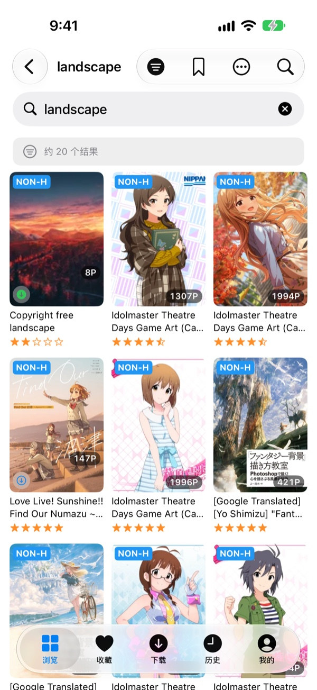 | 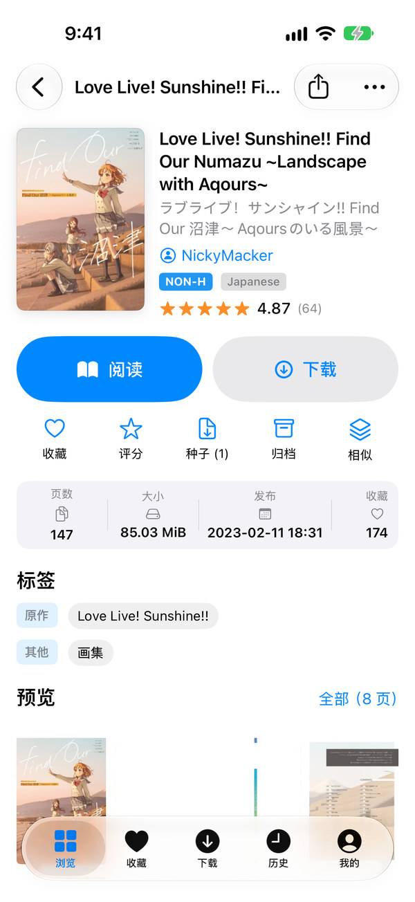 | 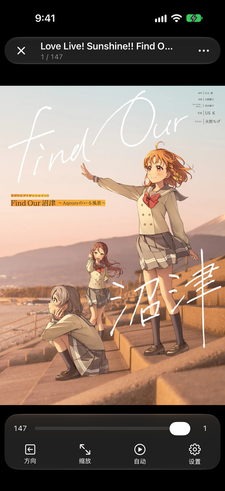 |
| **标签中文翻译** | **下载** | **深色模式** |
| 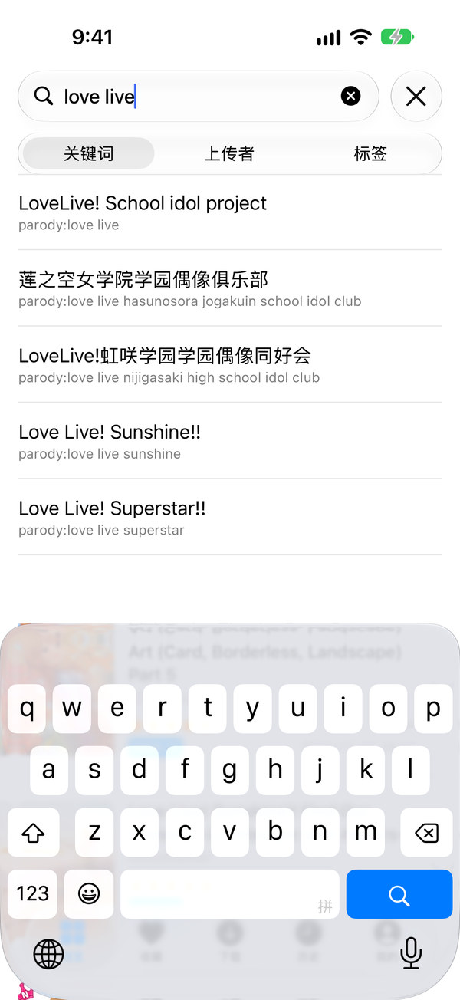 | 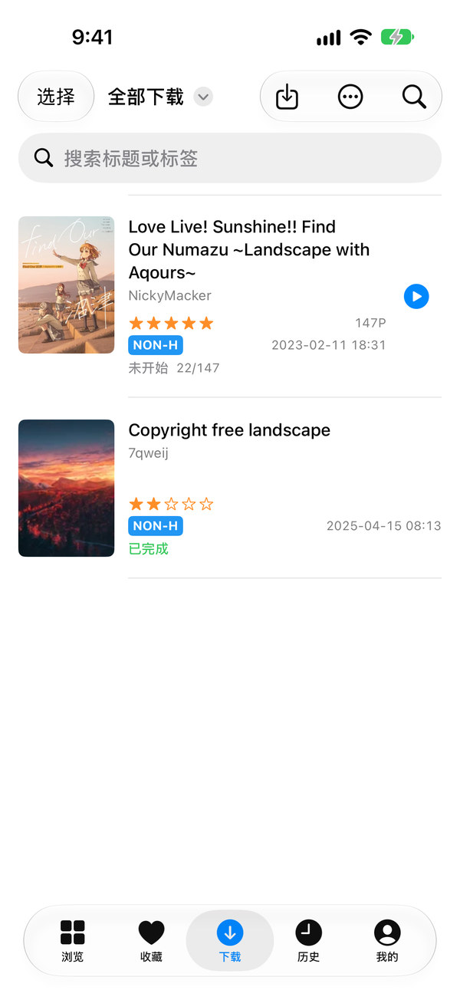 | 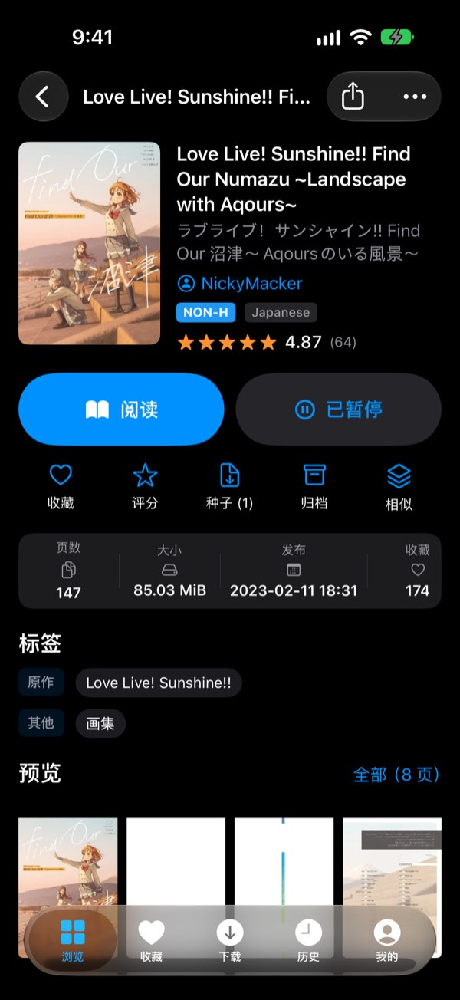 |

<details>
<summary><b>更多截图（含 iPad）</b></summary>

| 列表布局 | 预览 | 长按菜单 |
|:-:|:-:|:-:|
| 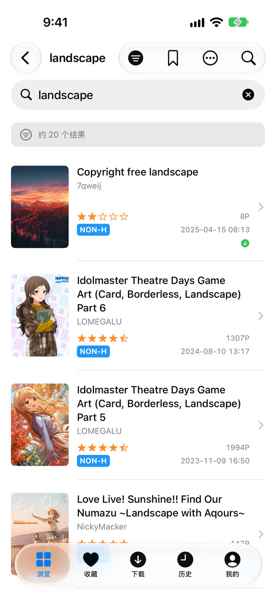 | 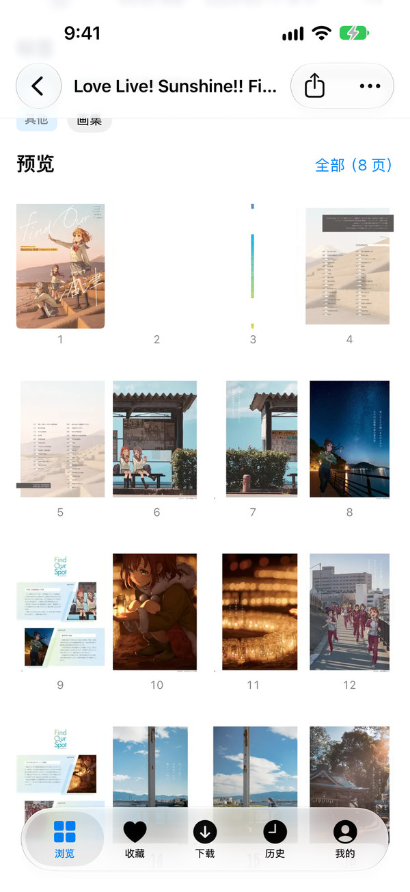 | 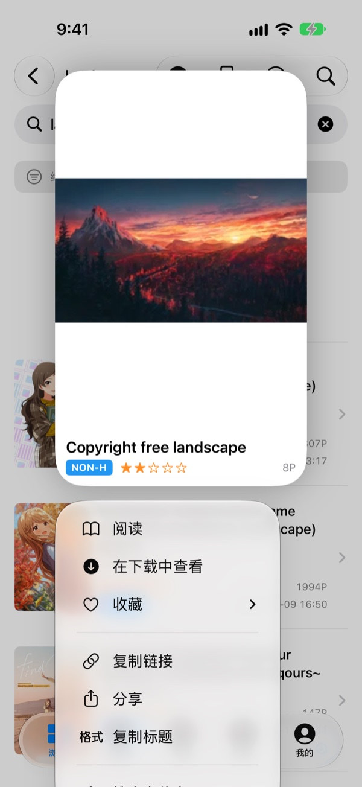 |
| **纵向阅读** | **阅读设置** | **后台下载设置** |
|  | 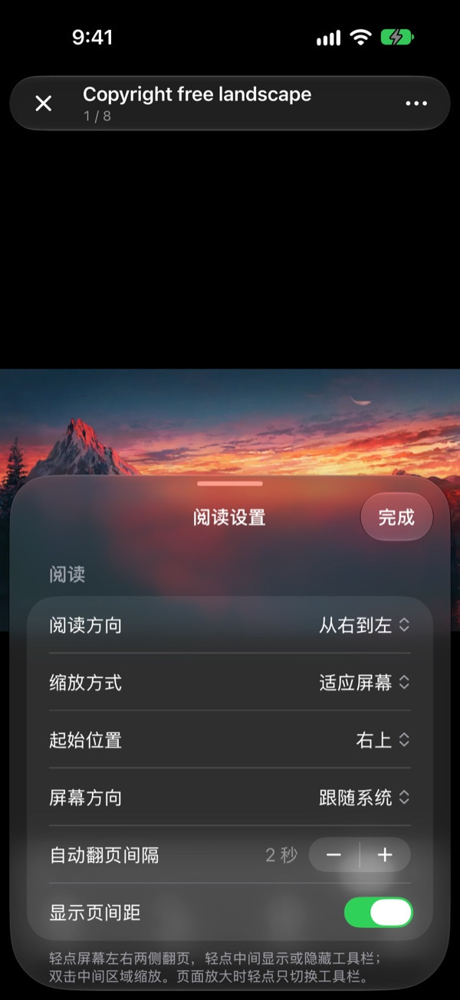 | 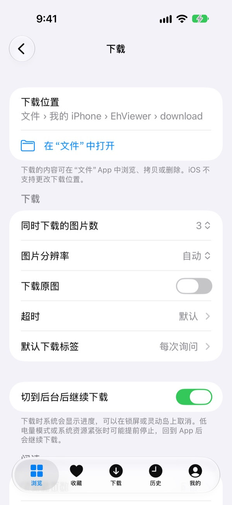 |
| **我的** | **网络设置** | **Wi-Fi 互传** |
| 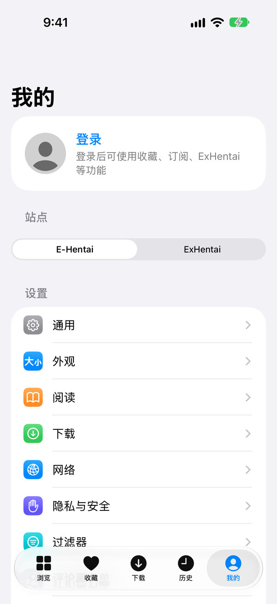 | 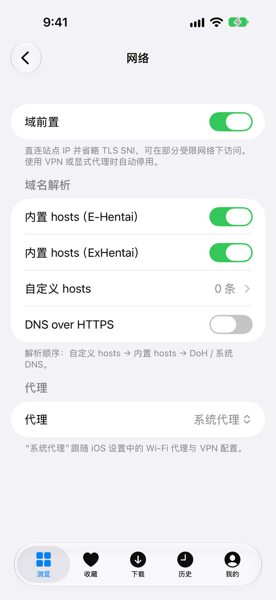 | 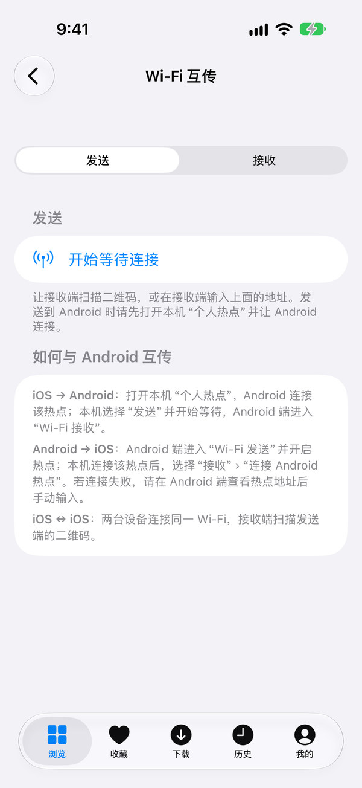 |

**iPad**

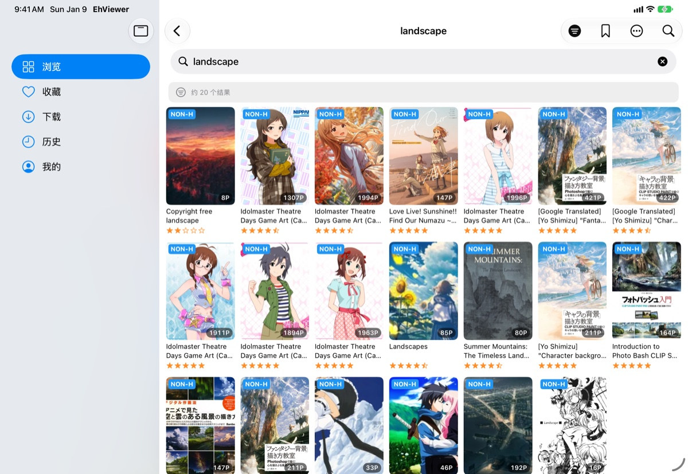

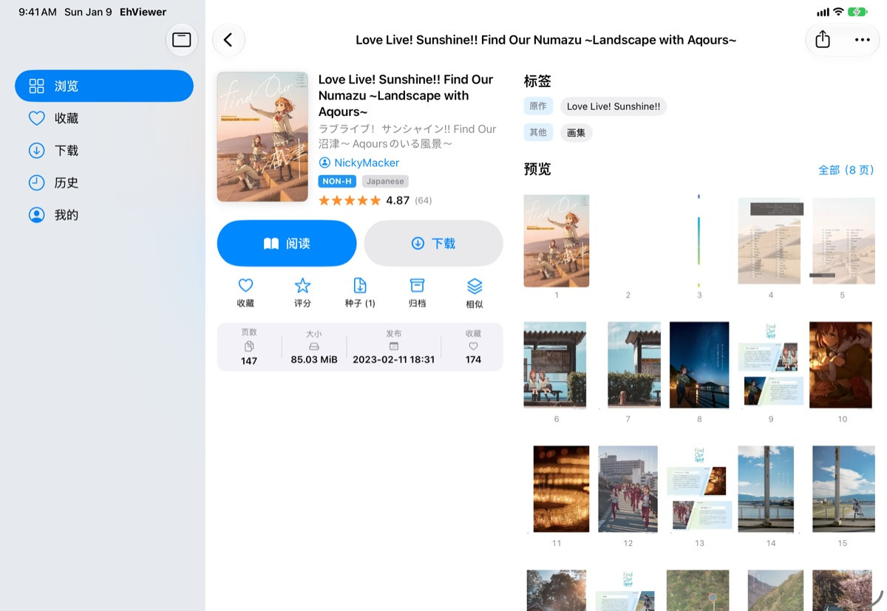

</details>

## 目录

- [来龙去脉](#来龙去脉)
- [功能](#功能)
- [安装](#安装)
  - [方式一：用 Xcode 编译安装（推荐）](#方式一用-xcode-编译安装推荐)
  - [方式二：用签名工具安装 IPA](#方式二用签名工具安装-ipa)
- [开始使用](#开始使用)
- [常见问题](#常见问题)
- [与 Android 版的差异](#与-android-版的差异)
- [开发](#开发)
- [致谢](#致谢)
- [许可证](#许可证)

## 来龙去脉

EhViewer 是 Android 上的 E-Hentai 客户端，最早由 Hippo Seven（[seven332](https://github.com/seven332/EhViewer)）开发。原版停更后，社区出现了多个分支，其中 [Ehviewer_CN_SXJ](https://github.com/xiaojieonly/Ehviewer_CN_SXJ)（xiaojieonly 维护）面向中文用户，至今仍在更新。

Ehviewer_CN_SXJ 只有 Android 版，这个项目把它移植到 iPhone 和 iPad：

- **原生重写**：不套网页，也不用跨平台框架，全部用 Swift 重写。
- **行为一致、数据互通**：
  - 业务逻辑逐个对照 Android 源码翻译，包括 HTML 解析、搜索 URL 构造、阅读加载调度（SpiderQueen）、下载管理、`.ehviewer` 文件格式、数据库表结构和 Wi-Fi 互传协议。
  - 因此可以导入 Android 版的下载目录、数据和设置，也能和 Android 设备通过 Wi-Fi 互传下载内容。
  - Android 版的单元测试样本和断言也移植了过来，EhKit 目前有近 400 个单元测试。
- **按 iOS 习惯设计界面**：底部标签栏、搜索栏、长按菜单、sheet、左右滑动操作，参照 Apple 人机界面指南（HIG）。

## 功能

| 模块 | 内容 |
|---|---|
| 浏览 | 首页、订阅、热门、排行榜、News；列表与网格两种布局；关键词、上传者、标签搜索；标签中文翻译建议；高级搜索；图片搜索；快速搜索；按页码或日期跳页 |
| 详情 | 信息、标签（中文翻译）、收藏（云端 0–9 或本地）、评分、评论（发表、编辑、投票）、预览、种子、归档下载（自动解压入库）、新版本、相似画廊 |
| 阅读器 | 左→右 / 右→左翻页、纵向条漫；缩放模式与起始位置；降采样解码；GIF；自动翻页；音量键与键盘翻页；亮度；保存到相册、分享；屏幕方向锁定 |
| 下载 | 标签管理、批量操作、排序与筛选、按标题与标签搜索（语法与站点相同，带标签建议）、完成通知；导入 zip、文件夹或 Android 下载目录；恢复下载项、清理冗余、清理无效 |
| 后台下载 | iOS 26 及以上：切到后台或锁屏后继续下载，系统在锁屏和灵动岛上显示进度。iOS 17、18：切到后台后只能继续约 30 秒，之后在系统允许时继续。详见[常见问题](#常见问题) |
| 账号 | 账号密码、Cookie、网页三种登录；额度查询与重置；我的标签；uconfig |
| 网络 | 域前置（直连 IP、不发 SNI，按真实域名校验证书）、内置 hosts、自定义 hosts、DoH、HTTP/SOCKS 代理 |
| 其他 | 过滤器、评论黑名单、应用锁（Face ID / 设备密码）、后台隐私遮罩、导入导出数据（兼容 Android 数据库与设置）、Wi-Fi 互传（与 Android 互通） |

界面目前只有简体中文。

## 安装

iOS 只能安装签过名的应用，App Store 之外的应用需要用自己的 Apple ID 签名，有两种方式：

| | 方式一：Xcode 编译 | 方式二：签名工具装 IPA |
|---|---|---|
| 需要 | Mac（能运行 Xcode 26 或更新版本） | Windows 或 Mac 电脑（视签名工具而定） |
| 包名（Bundle ID） | 自己设定 | 由签名工具处理 |
| 后台继续下载（iOS 26+） | 可用 | 签名工具改了 Bundle ID 时不可用 |

先了解几个概念：

- **Apple ID**：普通的免费 Apple ID 就能签名，不需要付费开发者账号。免费账号有三个限制：
  - 签名 7 天有效，过期后 App 打不开，重新安装一次即可，数据保留。
  - 同一台设备上最多同时装 3 个自签 App。
  - 每 7 天最多注册 10 个新的 Bundle ID。

  付费的 Apple Developer Program（每年 99 美元）签名有效期是 1 年，没有这些限制。
- **包名（Bundle ID）**：App 的唯一标识，形如 `com.yourname.ehviewer`。
  - 必须全球唯一，别人注册过的不能用，所以要设成你自己的。
  - 只能用字母、数字、连字符（`-`），用点分隔。
  - 确定后不要再改：同一个 Bundle ID 覆盖安装才能保留数据，改了 Bundle ID 就会装成另一个 App，数据不互通。
- **Team ID**：你的开发团队编号，10 位大写字母与数字。免费 Apple ID 在 Xcode 中登录后会自动得到一个"个人团队"（Personal Team）。

### 方式一：用 Xcode 编译安装（推荐）

**1. 准备工具**

- 在 Mac App Store 安装 Xcode（26 或更新版本），打开一次，按提示安装 iOS 平台组件。
- 安装 [Homebrew](https://brew.sh)，再安装 XcodeGen：

  ```bash
  brew install xcodegen
  ```

**2. 下载源码**

```bash
git clone https://github.com/ehviewer-ios/EhViewer-iOS.git
cd EhViewer-iOS
```

也可以在 GitHub 页面点 Code → Download ZIP，解压后在终端中进入该目录。

**3. 在 Xcode 中登录 Apple ID**

1. 打开 Xcode → Settings → Accounts，点左下角 `+`，选 Apple ID 并登录。
2. 选中刚登录的账号，点 Manage Certificates…，再点 `+` → Apple Development，创建开发证书。

**4. 设置包名和 Team ID**

```bash
scripts/setup-signing.sh com.yourname.ehviewer
```

- 把 `com.yourname.ehviewer` 换成你自己的包名，例如把 `yourname` 换成你的名字拼音或昵称。
- 脚本会从上一步创建的证书中读取 Team ID。有多个 Team 时，它会列出来，让你在命令末尾指定一个。
- 结果写在 `Config/Signing.xcconfig`。这个文件只在你的电脑上，不纳入版本控制。
- 也可以不用脚本：把 `Config/Signing.example.xcconfig` 复制为 `Config/Signing.xcconfig`，再手动填写这两项。

**5. 生成工程并打开**

```bash
xcodegen generate
open EhViewer.xcodeproj
```

第一次打开时，Xcode 会下载依赖库（Nuke、GRDB、SwiftSoup、ZIPFoundation），需要能访问 GitHub。

**6. 安装到手机**

1. 用数据线连接 iPhone，解锁手机，在弹窗中点"信任"。
2. 在 Xcode 顶部的设备菜单中选择你的 iPhone。
3. 建议改用 Release 配置，运行速度更快：菜单 Product → Scheme → Edit Scheme…，在 Run → Info 中把 Build Configuration 改为 Release。
4. 点 ▶ 或按 ⌘R，开始编译和安装。
5. 第一次安装时，还需要在手机上做两件事：
   - 打开开发者模式：设置 → 隐私与安全性 → 开发者模式，打开后按提示重启。
   - 信任开发者：设置 → 通用 → VPN 与设备管理，选择你的 Apple ID，点"信任"。

之后不插线也能安装：手机和 Mac 连同一个局域网时，Xcode 的设备菜单中仍能选到这台手机。

**续签与更新**

- 免费账号 7 天后签名过期。过期后重新执行第 6 步即可，数据保留。
- 更新到新版本：

  ```bash
  git pull
  xcodegen generate
  ```

  然后在 Xcode 中重新运行。只要 Bundle ID 和 Team 不变，覆盖安装就会保留数据。
- 也可以在终端安装：`DEVICE="你的 iPhone 名称" scripts/install-device.sh`，会用 Release 配置编译并安装到手机。
  - 设备名称可以用 `xcrun devicectl list devices` 查看。
  - 签名过期或第一次安装时，需要先在 Xcode 中运行一次，生成描述文件。

### 方式二：用签名工具安装 IPA

不需要 Mac，用签名工具把未签名的 IPA 签上你自己的 Apple ID 再安装：

1. 在 [Releases](https://github.com/ehviewer-ios/EhViewer-iOS/releases) 下载 `EhViewer-<版本>-unsigned.ipa`。也可以在 Mac 上用 `scripts/build-ipa.sh` 自己打包。
2. 用签名工具签名并安装，例如：
   - [Sideloadly](https://sideloadly.io)（Windows / macOS）
   - [AltStore](https://altstore.io)、[SideStore](https://sidestore.io)：可以自动续签
   - 其他支持自有证书（.p12 加描述文件）的签名工具
3. 第一次安装后，同样需要打开开发者模式、信任开发者，步骤见方式一第 6 步。

关于包名：

- 用免费 Apple ID 时，Bundle ID 必须是你独有的。如果工具提示 Bundle ID 不可用，在工具里改成你自己的。Sideloadly 在高级选项（Advanced Options）中可以修改，AltStore、SideStore 会自动改。
- 签名工具改了 Bundle ID 后，iOS 26 的「切到后台后继续下载」不可用。这是因为后台任务的标识在编译时就写进了 Info.plist，而系统要求它以 Bundle ID 开头。其他功能不受影响。
- 想用完整功能，有两个办法：
  - 用方式一编译安装。
  - 在 Mac 上用你自己的 Bundle ID 打包，签名时不再改 Bundle ID：

    ```bash
    BUNDLE_ID=com.yourname.ehviewer scripts/build-ipa.sh
    ```

## 开始使用

- **登录**：在"我的"中登录，支持账号密码、Cookie、网页三种方式。ExHentai 需要登录，且账号要有访问权限。
- **网络受限时**：我的 → 设置 → 网络，可开启域前置、内置 hosts、DNS over HTTPS，或设置代理。
  - 开启域前置时，网页登录不可用，请改用账号密码或 Cookie 登录。
- **从 Android 迁移**：
  - Wi-Fi 互传：我的 → Wi-Fi 互传，页面中有与 Android 互传的步骤。
  - 下载内容：把 Android 的下载目录拷到 iPhone 的"文件" App 中，然后在 下载 → 导入 → 导入 Android 下载目录。
  - 数据：Android 版导出的数据文件，在 我的 → 设置 → 高级 → 导入数据 中导入。导入内容包括下载列表、历史、快速搜索、本地收藏、过滤器等。
  - 设置：我的 → 设置 → 高级 → 导入 Android 设置，选择 Android 端 `shared_prefs` 文件夹中的 `com.xjs.ehviewer_preferences.xml`。
- **下载的文件**：在"文件" App → 我的 iPhone → EhViewer → download 中可以看到。

## 常见问题

**App 打不开，或闪退后提示无法验证**

可能有两种情况：

- 签名过期：免费账号为 7 天，重新安装即可，数据保留。
- 第一次安装后还没有打开开发者模式，或还没有信任开发者，见方式一第 6 步。

**安装时提示 App 数量达到上限**

免费账号在同一台设备上最多同时装 3 个自签 App，删掉一个再装。

**Xcode 提示 Bundle ID 无法注册（"cannot be registered to your development team" 或 "not available"）**

这个 Bundle ID 已被别人注册过，换一个，例如在末尾加上你的名字。

**Xcode 提示 App ID 数量达到上限（"maximum number of App IDs"）**

免费账号每 7 天最多注册 10 个 Bundle ID。可以等几天，或者改回以前用过的 Bundle ID。

**切到后台后下载停了**

- iOS 26 及以上：开始下载后，系统会显示下载进度，切到后台也继续下载。低电量模式或系统资源紧张时，系统可能提前结束任务，回到 App 后会继续下载。这个功能可以在 我的 → 设置 → 下载 → 切到后台后继续下载 中关闭。
- iOS 17、18：切到后台后只能继续约 30 秒。之后系统允许时（通常要充电且闲置）会再继续。
- 用签名工具改了 Bundle ID 时，iOS 26 的后台继续下载不可用，见[方式二](#方式二用签名工具安装-ipa)。

**更新会丢数据吗**

- 不会：只要 Bundle ID 和 Team 都不变，覆盖安装就会保留数据。
- 会丢：删除 App，或换了 Bundle ID（会装成另一个 App）。
- 重要的数据可以在 我的 → 设置 → 高级 → 导出数据 中备份。

## 与 Android 版的差异

- **网页登录不走域前置**：WKWebView 无法接管 https 请求，开启域前置时请改用账号密码或 Cookie 登录。
- **下载在后台的时间受系统限制**：
  - iOS 26 及以上：下载时申请持续处理任务，切到后台后继续下载，系统显示进度，可以在系统界面中取消。
  - iOS 17、18，或系统没有批准任务时：进入后台后只能继续约 30 秒，之后由 BGProcessingTask 在系统允许时续跑。
  - 诊断日志在 App 的 `Library/Caches/download.log`，同时记录页面下载失败的原因。
  - 归档（zip）下载支持断点续传。
- **下载失败时重试更积极**：Android 遇到图片页请求出错会直接放弃这一页，于是整本停在 213/214 之类的进度并标记失败。这里改为：
  - 网络错误、5xx、临时错误页：等待后重试。
  - 被站点限流（Cloudflare 质询、429/503）：所有下载线程暂停 15–60 秒后继续。
  - 所有页跑完后，失败页再补下两轮（10 秒、30 秒后）。
  - 509、封禁等错误仍直接失败。
- **不支持 rar/7z 导入**：只支持 zip/cbz。
- **Wi-Fi 互传有限制**：
  - Android 端本来就没有二维码，iOS 端新增了二维码。
  - Android 作为接收端时，下载项会因为其自身的 bug 无法入库，详见 `EhKit/Sources/EhCore/Transfer`。
- **不支持的功能**：APK 自更新、统计、刷新率设置、媒体库扫描等。

## 开发

### 工程结构

```
EhKit/            SwiftPM 包（非 UI 逻辑，单元测试用 Swift Testing）
  EhCore          模型、URL、全部解析器、标签翻译、.ehviewer 文本/CBOR、互传帧协议（纯 Foundation，Linux 可测）
  EhNetwork       传输层（URLSession / 域前置 HTTP/1.1）、DNS（hosts/DoH）、Cookie、EhAPI（对应 EhEngine）
  EhStorage       GRDB 数据库（兼容 greenDAO schema v8）、设置、过滤器、目录
  EhSpider        阅读加载器、下载管理、归档下载与解压、导入
  EhTransfer      Wi-Fi 互传（Network.framework）
App/              SwiftUI 应用（阅读器为 UIKit）
AppUITests/       UI 测试
Config/           构建设置（xcconfig），本机签名设置在 Signing.xcconfig
project.yml       XcodeGen 工程定义（project-uitests.yml 另加 UI 测试 target）
scripts/          构建脚本
docs/             移植规范（PORTING.md）与 App 设计（APP_DESIGN.md）
```

### 编译与测试

- 单元测试：`cd EhKit && swift test`。macOS 上需要完整的 Xcode；也能在装了 Swift 6 工具链的 Linux 上跑。
- 模拟器编译：`scripts/build-sim.sh`，输出错误摘要。
- 模拟器运行并截图：`scripts/sim-run.sh shot.png 10`，截图在 `build/shots/`。
- UI 测试：`scripts/ui-test.sh`。
  - 会访问 E-Hentai，需要网络，请不要频繁运行。
  - 截图在 `build/shots/ui/`。
  - 模拟器可用 `SIM_DEVICE` 指定。
- 未签名 IPA：`scripts/build-ipa.sh`。
- README 截图：`scripts/readme-shots.sh`，在单独的 iPhone 和 iPad 模拟器中拍摄，只打开 Non-H 分类的内容。

UI 测试使用单独的工程定义 `project-uitests.yml`，它在 `project.yml` 的基础上加入 `AppUITests`，因此装到真机的工程不受影响。

### 调试启动参数

只在通过启动参数传入时生效，供自动化截图和冒烟测试使用：

| 参数 | 作用 |
|---|---|
| `-EHDisableImages YES` | 不加载缩略图；阅读器显示占位图 |
| `-EHInitialTab favorites\|downloads\|history\|me` | 启动时打开指定 Tab |
| `-EHOpenURL <站点链接>` | 启动后打开链接 |
| `-EHOpenReader YES` | 配合 `-EHOpenURL`，直接进入阅读器 |
| `-EHStartDownload YES` | 配合 `-EHOpenURL`，直接开始下载 |

## 致谢

- [EhViewer](https://github.com/seven332/EhViewer)：原作者 Hippo Seven
- [Ehviewer_CN_SXJ](https://github.com/xiaojieonly/Ehviewer_CN_SXJ)：xiaojieonly 及贡献者，本项目的移植来源
- [EhTagTranslation](https://github.com/EhTagTranslation/Database)：标签中文翻译
- 依赖库：[Nuke](https://github.com/kean/Nuke)、[GRDB.swift](https://github.com/groue/GRDB.swift)、[SwiftSoup](https://github.com/scinfu/SwiftSoup)、[ZIPFoundation](https://github.com/weichsel/ZIPFoundation)（均为 MIT 许可证）
- 工程生成：[XcodeGen](https://github.com/yonaskolb/XcodeGen)

## 许可证

[GNU General Public License v3.0](LICENSE)，与 Ehviewer_CN_SXJ 一致。原版 EhViewer 的代码以 Apache License 2.0 发布，相关声明见 [NOTICE](NOTICE)。
